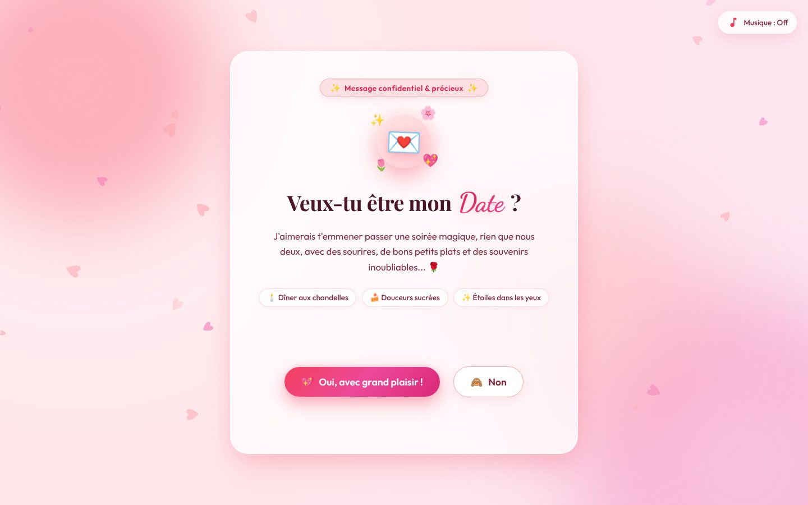

# 💖 Site d'Invitation en Date Romantique ("Dis Oui !")

Un site web interactif, poétique et romantique conçu pour faire une demande de date irrésistible.

**Démo en ligne :** [date-propose.vercel.app](https://date-propose.vercel.app)

## ✨ Fonctionnalités

- **Palette Féérique Rose & Rose Pâle** : Tons rose poudré, dégradés pastel, reflets lumineux et effets de verre dépoli (*glassmorphism*).
- **Bouton "Non" Fuyant & Intelligent** : Dès que la souris s'approche ou que l'on clique dessus, le bouton s'échappe avec des animations fluides et des messages taquins.
- **Bouton "Oui" Magnétique** : Grossit et brille de plus en plus à chaque tentative sur le bouton "Non".
- **Célébration Magique** : Pluie de confettis et cœurs, billet de rendez-vous officiel VIP, checklist de promesses et lien WhatsApp pré-rempli pour confirmer le date.
- **Ambiance Musique Douce** : Synthétiseur de mélodie romantique lofi relaxante intégré (Web Audio API).
- **Particules de Cœurs Flottantes** : Cœurs animés générés en temps réel sur canvas.

## 🛠️ Technique

Aucune dépendance : HTML, CSS et JavaScript sans framework.

- Cœurs flottants dessinés en temps réel sur un `<canvas>`
- Mélodie synthétisée avec la Web Audio API, sans fichier audio
- Bouton « Non » qui calcule une nouvelle position à l'approche du curseur, en restant dans l'écran

## 🚀 Comment l'ouvrir

Il suffit de double-cliquer sur le fichier `index.html` ou de l'ouvrir dans n'importe quel navigateur web (Chrome, Safari, Firefox, Edge, smartphone ou ordinateur).

## 💌 Personnalisation facile

Dans `index.html` :
- **Son prénom / surnom** : Vous pouvez modifier le titre `<h1>` pour ajouter son prénom (ex: *« Léa, veux-tu être mon Date ? »*).
- **Le programme du Date** : Modifiez les éléments de la liste dans le `ticket-details` ou la `date-checklist`.
- **Le message WhatsApp** : Modifiez la variable `loveMessage` dans `script.js` pour personnaliser le message automatique envoyé.

## 👤 Auteur

**Ayoub Touat** · [@medazero01-art](https://github.com/medazero01-art)
